# 图解 Transformer

Jay Alammar 作。原文写于 2018-06-27：[The Illustrated Transformer](https://jalammar.github.io/illustrated-transformer/)。

本文是该文的中文翻译。插画从原文保存到同目录的 `images/`，许可为 [CC BY-NC-SA 4.0](https://creativecommons.org/licenses/by-nc-sa/4.0/)。

讨论：[Hacker News（65 分，4 条评论）](https://news.ycombinator.com/item?id=18351674)，[Reddit r/MachineLearning（29 分，3 条评论）](https://www.reddit.com/r/MachineLearning/comments/8uh2yz/p_the_illustrated_transformer_a_visual_look_at/)

已有译本：[阿拉伯语](https://www.mundhor.site/post/post14)，[简体中文 1](https://blog.csdn.net/yujianmin1990/article/details/85221271)，[简体中文 2](https://blog.csdn.net/qq_36667170/article/details/124359818)，[法语 1](https://a-coles.github.io/2020/11/15/transformer-illustre.html)，[法语 2](https://lbourdois.github.io/blog/nlp/Transformer/)，[意大利语](https://medium.com/@val.mannucci/il-transformer-illustrato-it-37a78e3e2348)，[日语](https://tips-memo.com/translation-jayalmmar-transformer)，[韩语](https://nlpinkorean.github.io/illustrated-transformer/)，[波斯语](http://dml.qom.ac.ir/2022/05/17/illustrated-transformer/)，[俄语](https://habr.com/ru/post/486358/)，[西班牙语 1](https://www.ibidemgroup.com/edu/transformer-ilustrado-jay-alammar/)，[西班牙语 2](https://hackernoon.com/el-transformador-ilustrado-una-traduccion-al-espanol-0y73wwp)，[越南语](https://trituenhantao.io/tin-tuc/minh-hoa-transformer/)

视频：MIT 的 [Deep Learning State of the Art](https://youtu.be/53YvP6gdD7U?t=432) 讲座引用过这篇。

入选课程：[Stanford](https://web.stanford.edu/class/cs224n/)，[Harvard](https://scholar.harvard.edu/binxuw/classes/machine-learning-scratch/materials/transformers)，[MIT](https://ocw.mit.edu/courses/6-s897-machine-learning-for-healthcare-spring-2019/d39a6eed387ee90b1f72a01949c35c7b_MIT6_S897S19_lec8.pdf)，[Princeton](https://www.cs.princeton.edu/courses/archive/fall22/cos597G/)，[CMU](https://www.cs.cmu.edu/~leili/course/mldl22w/14-Transformer.pdf)，以及其他学校。

[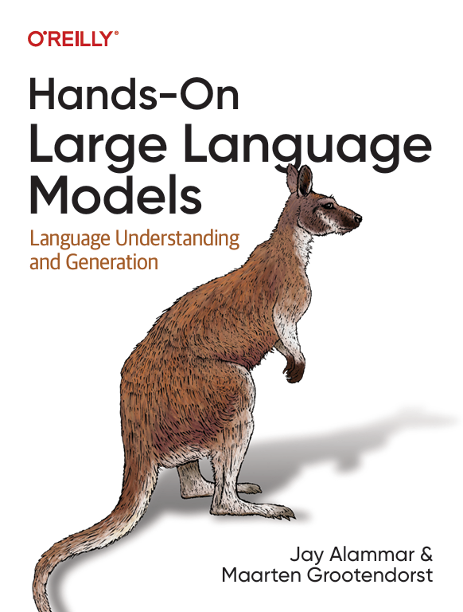](https://www.llm-book.com)

**更新：** 这篇博客已经收成一本书。看 [LLM-book.com](https://llm-book.com)。书的第 3 章是本文的更新和扩充，讲的是最初那版 Transformer 出现七年之后的模型，以及它们怎么演变，比如 Multi-Query Attention 和 RoPE 位置嵌入。

[上一篇里我们看过注意力](https://jalammar.github.io/visualizing-neural-machine-translation-mechanics-of-seq2seq-models-with-attention/)。它在现在的深度学习模型里几乎无处不在，也帮神经机器翻译把效果做上去了。这一篇看 **Transformer**。它用注意力把这类模型的训练速度提上来。在一些具体任务上，Transformer 超过了 Google 的神经机器翻译模型。更大的好处是它适合并行。Google Cloud 建议拿 Transformer 当参考模型，来用他们的 [Cloud TPU](https://cloud.google.com/tpu/)。下面把它拆开，看它怎么工作。

Transformer 出自论文 [Attention is All You Need](https://arxiv.org/abs/1706.03762)（《注意力就是你所需要的一切》）。TensorFlow 实现在 [Tensor2Tensor](https://github.com/tensorflow/tensor2tensor) 里。哈佛 NLP 组写过一份 [对照论文的 PyTorch 实现导读](http://nlp.seas.harvard.edu/2018/04/03/attention.html)。这篇会把事情讲得简单一些，一个概念一个概念地引进来，让没有深入背景的人也能跟上。

**2025 更新：** 我们做了一门 [免费短课](https://bit.ly/4aRnn7Z)，用动画把这篇的内容更新到现在。课程视频：[YouTube](https://www.youtube.com/watch?v=k1ILy23t89E)。

## 先看整体

先把模型看成一个黑盒。做机器翻译时，它吃进一种语言的句子，吐出另一种语言的译文。

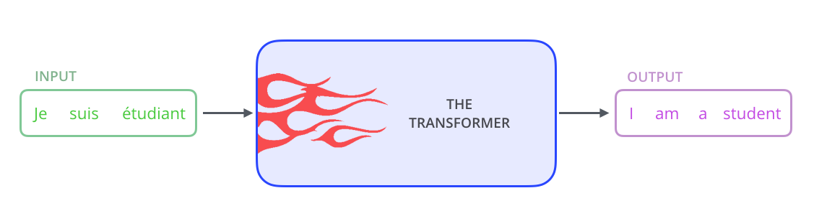

把这台「擎天柱」拆开，能看到一块编码组件、一块解码组件，以及两者之间的连接。

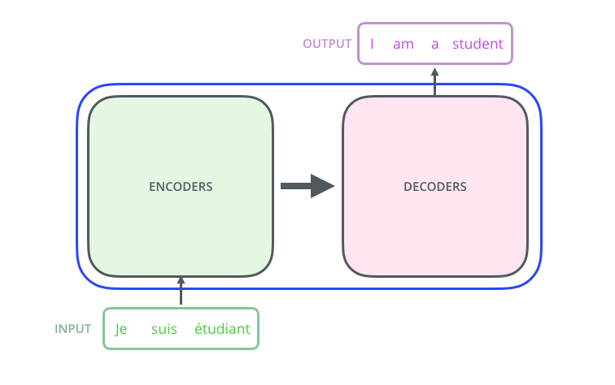

编码组件是一叠编码器。论文把 6 个叠在一起。6 这个数字没有魔法，完全可以试别的摆法。解码组件是同样个数的解码器，也叠成一叠。

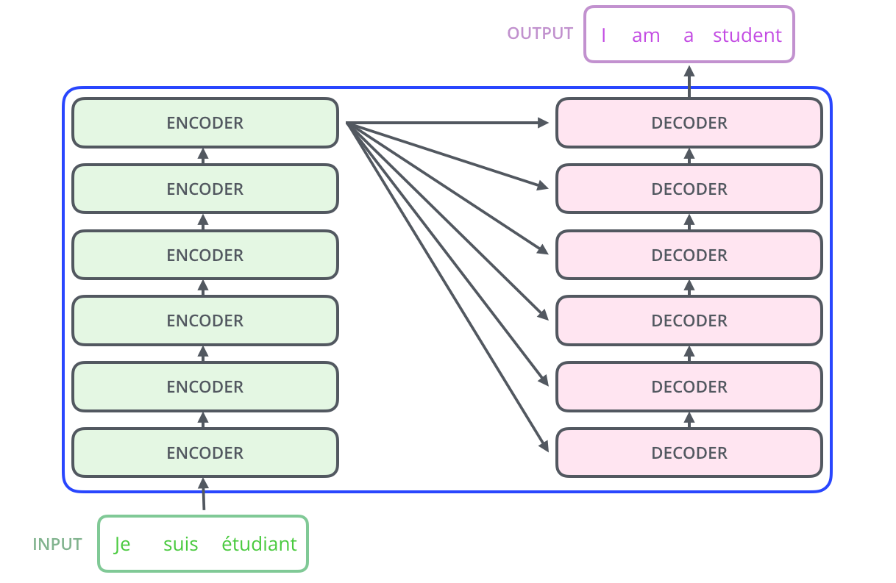

这些编码器结构完全一样，但权重不共享。每一个都拆成两个子层：

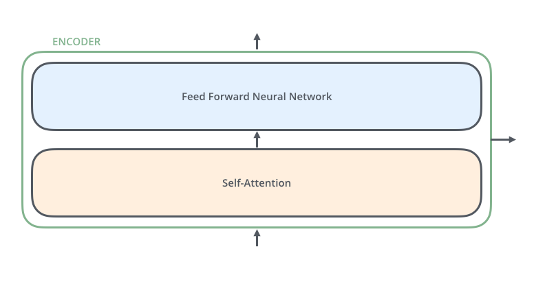

编码器的输入先过自注意力层。编码某个词的时候，这一层会去看输入句子里的其他词。自注意力后面会细讲。

自注意力层的输出再送进一个前馈神经网络。同一个前馈网络会独立地用到每一个位置上。

解码器里也有这两层，两层中间还夹着一个注意力层，让解码器去盯输入句子里相关的部分。这和 [seq2seq 模型](https://jalammar.github.io/visualizing-neural-machine-translation-mechanics-of-seq2seq-models-with-attention/)里的注意力是同一类事情。

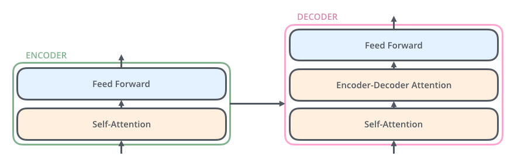

## 把张量放进这张图

主要部件看过了。接下来看各种向量和张量怎么在这些部件之间流动，把一个训好的模型的输入变成输出。

和一般的 NLP 一样，我们先用一种 [嵌入算法](https://medium.com/deeper-learning/glossary-of-deep-learning-word-embedding-f90c3cec34ca)，把每个输入词变成一个向量。

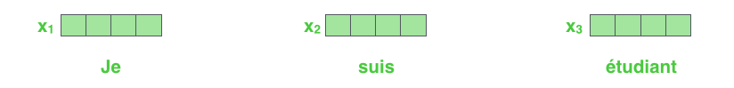

每个词嵌进一个 512 维的向量。下面用这种简单的方块来画这些向量。

嵌入只发生在最底下那个编码器。所有编码器共用的抽象是：它们都收到一列向量，每个向量大小是 512。最底下那个编码器收到的是词嵌入；上面的编码器收到的是紧挨在它下面的那个编码器的输出。这一列有多长，是我们可以设的超参数，基本上就是训练集里最长那句话的长度。

输入序列里的词嵌完之后，每一个都要流过编码器的两层。

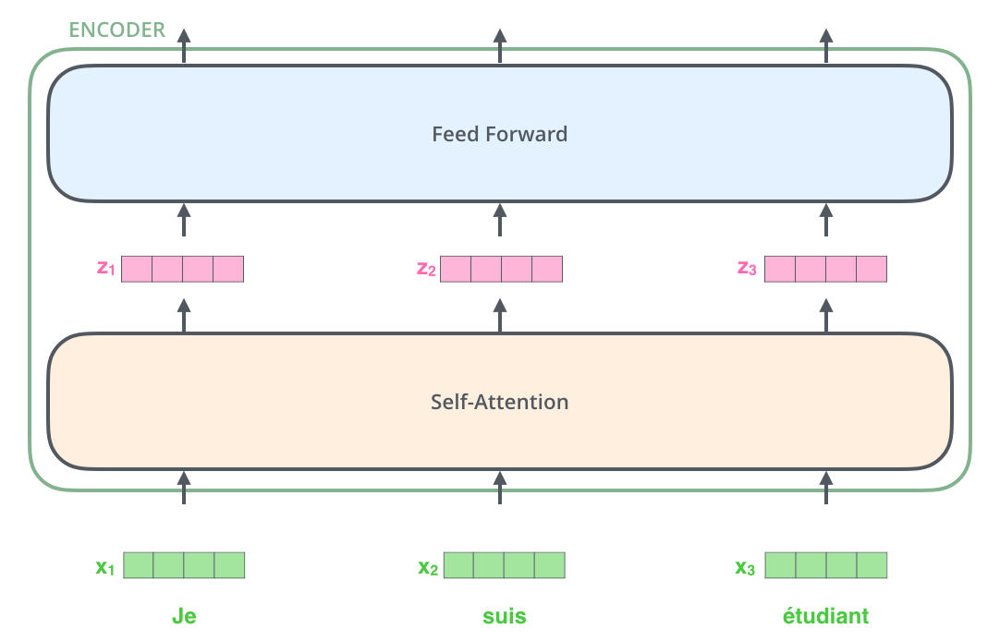

这里能看到 Transformer 的一个关键性质：每个位置上的词，在编码器里走自己的一条路径。这些路径在自注意力层里彼此有依赖。前馈层没有这种依赖，所以流过前馈层时，各条路径可以并行执行。

接下来换成一个更短的句子，看编码器每个子层里发生了什么。

## 开始编码

前面说过，编码器的输入是一列向量。它把这些向量送进自注意力层，再送进前馈神经网络，然后把输出往上交给下一个编码器。

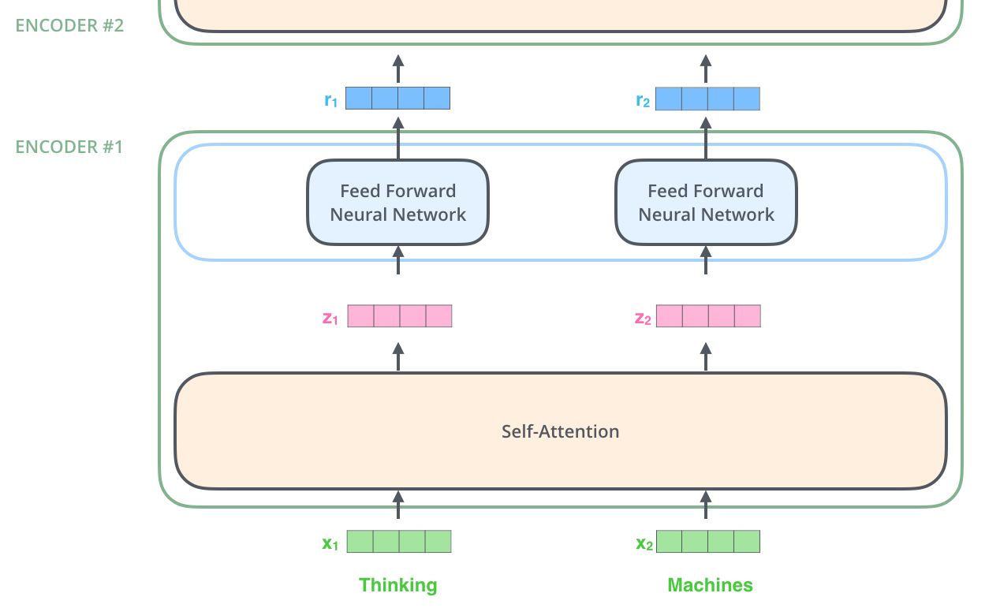

每个位置上的词都过一遍自注意力。然后各自再过一个前馈神经网络。网络是同一个，每个向量分开流过去。

## 自注意力，先讲直觉

别因为我把「自注意力」这个词挂在嘴边，就以为它是个人人都该懂的概念。我自己也是读到 [Attention is All You Need](https://arxiv.org/abs/1706.03762) 才第一次碰到它。下面把它怎么工作拆开讲。

假设要翻译的输入句是：

「The animal didn't cross the street because it was too tired」

这句话里的 it 指什么？是 street，还是 animal？对人来说这是个简单问题，对算法就没那么简单。

模型处理 it 这个词的时候，自注意力让它把 it 和 animal 连上。

模型每处理一个词（输入序列里的一个位置），自注意力都允许它去看输入序列里的其他位置，找能帮这个词编出更好表示的线索。

如果你熟悉 RNN，可以想一想：RNN 靠维护一个隐藏状态，把前面处理过的词或向量的表示，卷进当前正在处理的这个词里。自注意力就是 Transformer 用来把「其他相关词的理解」烘进当前这个词的办法。

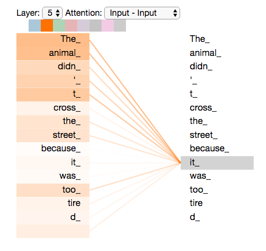

我们在 5 号编码器（这一叠最上面那个）里编码 it 时，注意力机制有一部分盯着 The Animal，并把它的表示烤进了 it 的编码里。

可以去看看 [Tensor2Tensor 的 notebook](https://colab.research.google.com/github/tensorflow/tensor2tensor/blob/master/tensor2tensor/notebooks/hello_t2t.ipynb)。那里能加载一个 Transformer，并用这种交互可视化来检查它。

## 自注意力的细节

先用向量把自注意力怎么算讲清楚，再看它实际怎么实现，也就是用矩阵。

计算自注意力的 **第一步**，是从编码器的每个输入向量（这里就是每个词的嵌入）造出三个向量。于是每个词都有一个 Query 向量、一个 Key 向量、一个 Value 向量。这三个向量，是用嵌入去乘训练过程中学出来的三个矩阵得到的。

注意，这些新向量比嵌入向量短。它们的维度是 64，嵌入以及编码器的输入、输出向量维度是 512。它们不一定得更小。这是一种架构选择，为的是让多头注意力的计算量大体保持恒定。

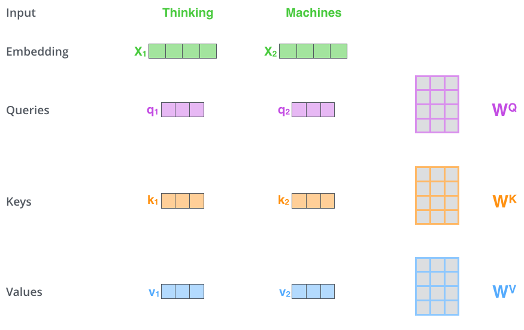

x1 乘以权重矩阵 WQ，得到 q1，也就是这个词对应的 query 向量。输入句子里的每个词，最后都会得到一个 query、一个 key、一个 value 投影。

query、key、value 这三个向量是什么？

它们是为了计算注意力、也是为了思考注意力而设的抽象。把下面的计算读完，你就知道每个向量扮演什么角色了。

计算自注意力的 **第二步** 是打分。假设我们在算这个例子里第一个词 Thinking 的自注意力。需要拿输入句子里的每个词，对这个词打一个分。这个分数决定：编码某个位置上的词时，该把多少注意力放在输入句子的其他部分。

分数是 query 向量和对应词的 key 向量的点积。如果正在处理 1 号位置那个词的自注意力，第一个分数就是 q1 和 k1 的点积，第二个分数就是 q1 和 k2 的点积。

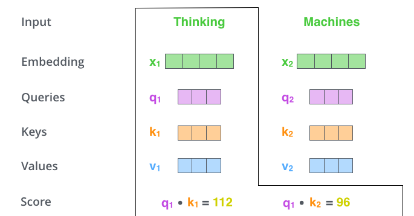

**第三步和第四步**：把分数除以 8。8 是论文里 key 向量维度 64 的平方根。这样做梯度更稳定。这里也可以用别的值，8 是默认值。然后把结果送进 softmax。softmax 把分数归一化，让它们全是正数，并且加起来等于 1。

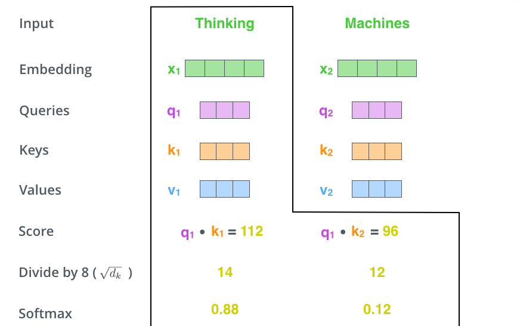

这个 softmax 分数决定每个词在这个位置上会被表达多少。当前位置这个词的 softmax 分数通常最高，但有时去关注另一个和当前词相关的词是有用的。

**第五步**，把每个 value 向量乘上对应的 softmax 分数，准备把它们加起来。直觉是：想关注的那些词，它们的 value 保持原样；不相干的词，乘上一个很小的数，比如 0.001，就被压下去了。

**第六步**，把加权后的 value 向量加起来。加出来的结果，就是自注意力层在这个位置上的输出（对第一个词而言）。

自注意力的计算到这里就结束了。得到的向量可以送进前馈神经网络。实际实现里，为了算得更快，这一步是用矩阵做的。词这个层面的直觉看过了，下面看矩阵。

## 用矩阵计算自注意力

**第一步** 是算出 Query、Key、Value 三个矩阵。把嵌入排成一个矩阵 X，再乘上训练好的权重矩阵 WQ、WK、WV。

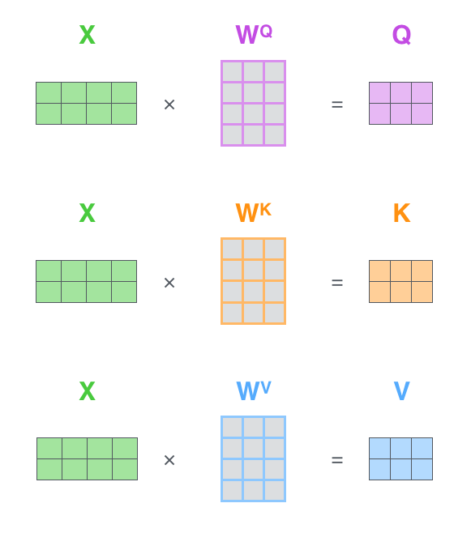

X 的每一行对应输入句子里的一个词。这里又能看到尺寸差：嵌入向量是 512 维（图里画成 4 个方块），q、k、v 向量是 64 维（图里画成 3 个方块）。

**最后**，既然手头是矩阵，可以把第二步到第六步收成一个公式，用来算自注意力层的输出。

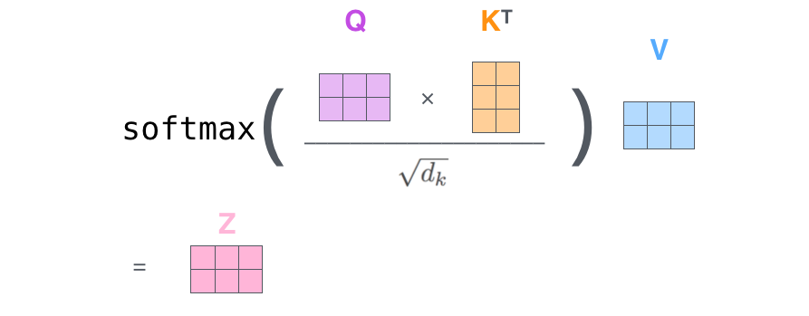

矩阵形式的自注意力就是：

$$
Z = \mathrm{softmax}\!\left(\frac{QK^{\mathsf T}}{\sqrt{d_k}}\right)V
$$

## 长着许多头的猛兽

论文又往前走了一步，给自注意力层加了一个叫「多头」的机制。它从两头改善注意力层的效果。

1. 它让模型能够关注不同的位置。是的，上面的例子里 z1 已经含着其他编码的一点点信息，但它仍可能被这个词自己占掉大半。翻译 The animal didn't cross the street because it was too tired 这种句子时，知道 it 指的是哪个词会有用。

2. 它给注意力层多个「表示子空间」。下面会看到，多头注意力不止一套 Query、Key、Value 权重矩阵，而是多套。Transformer 用 8 个注意力头，所以每个编码器、解码器各有 8 套。每套都随机初始化。训练之后，每套把输入嵌入（或更下层编码器、解码器传来的向量）投影到一个不同的表示子空间。

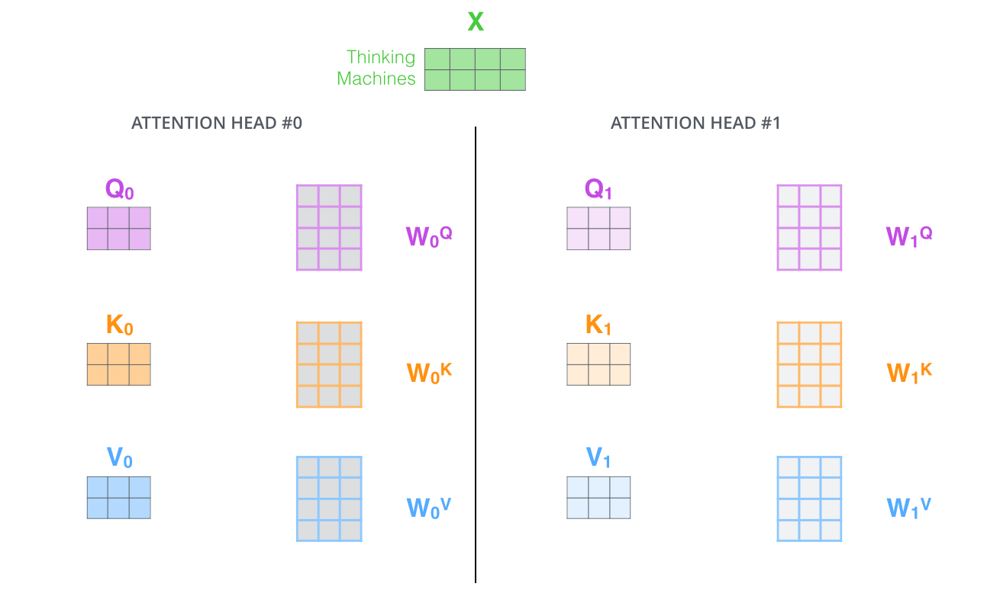

有了多头注意力，每个头维持各自的 Q、K、V 权重矩阵，于是得到不同的 Q、K、V。和前面一样，用 X 去乘 WQ、WK、WV，得到 Q、K、V。

把上面那套自注意力计算做 8 遍，每遍用不同的权重矩阵，就会得到 8 个不同的 Z 矩阵。

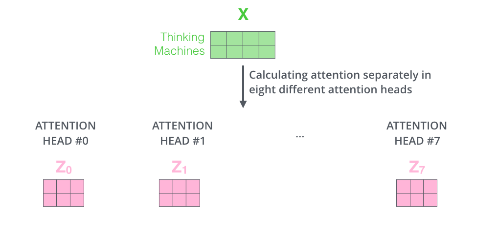

这里有个麻烦。前馈层不接受 8 个矩阵，它要的是一个矩阵（每个词一个向量）。所以得把这 8 个收成一个。

怎么收？把这些矩阵拼起来，再乘一个额外的权重矩阵 WO。

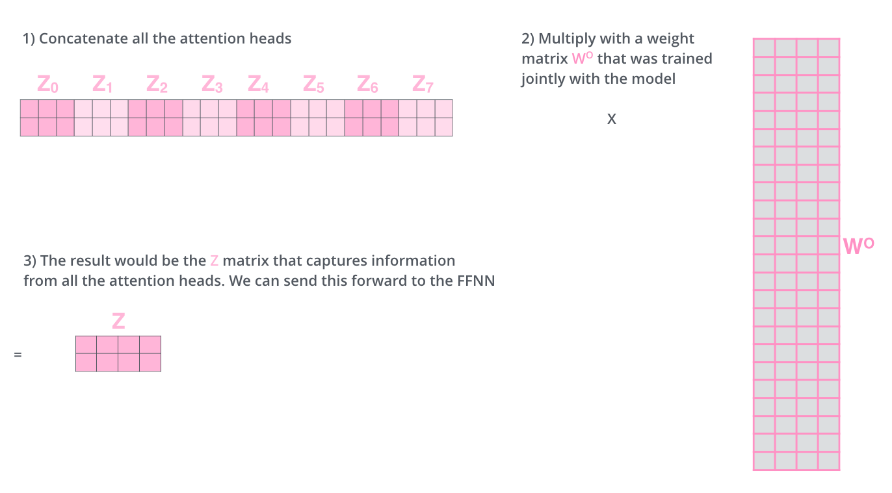

多头自注意力大体就是这些。矩阵确实多。我把它们放进一张图里，好在一个地方看全。

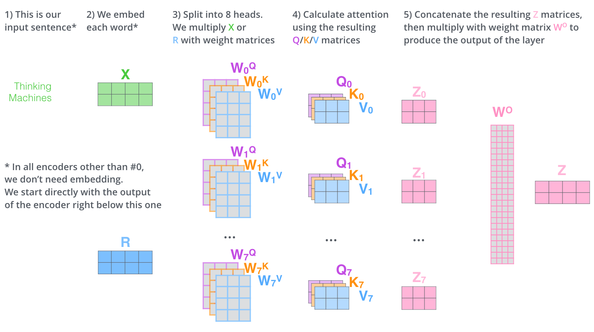

注意力头碰到了。回到前面的例子，看编码 it 的时候，不同的头各自盯着哪里：

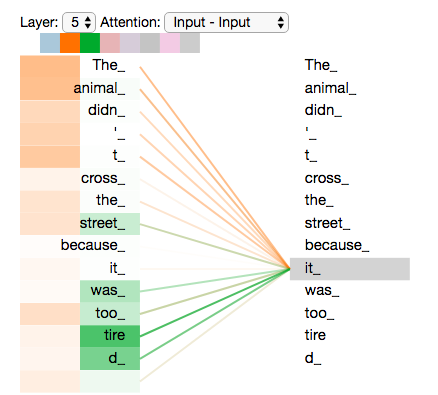

编码 it 时，一个注意力头大部分落在 the animal 上，另一个落在 tired 上。可以说，模型对 it 的表示里，烘进了一部分 animal 的表示，也烘进了一部分 tired 的表示。

如果把所有注意力头都画上去，就更难读了：

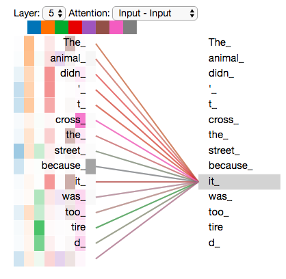

## 用位置编码表示序列的顺序

到目前为止，这个模型还缺一件事：它还没法表示输入序列里词的顺序。

为此，Transformer 给每个输入嵌入加上一个向量。这些向量遵循一种特定模式，模型能从中判断每个词的位置，以及不同词之间的距离。直觉是：把这些值加进嵌入之后，嵌入向量再投影成 Q、K、V、做点积注意力时，向量之间会带上有意义的距离。

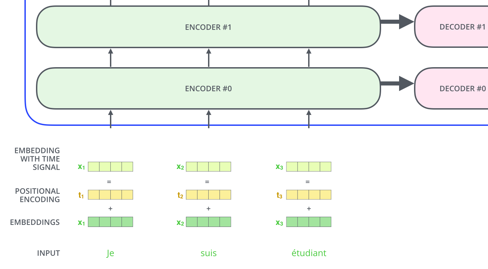

为了让模型感觉到词的顺序，我们加上位置编码向量，它们的取值遵循一种特定模式。

假如嵌入维度是 4，真实的位置编码长这样：

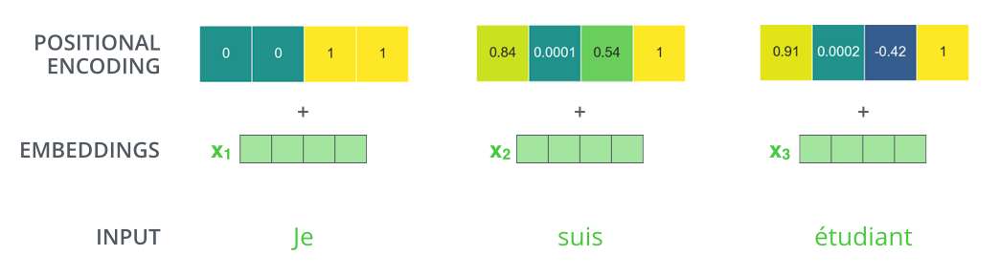

嵌入尺寸只有 4 的一个位置编码实例。

这种模式长什么样？

下面这张图里，每一行是一个位置的编码向量。第一行就是要加到输入序列第一个词的嵌入上的那个向量。每一行有 512 个数，每个数都在 1 和 -1 之间。上了色之后，模式就看得见了。

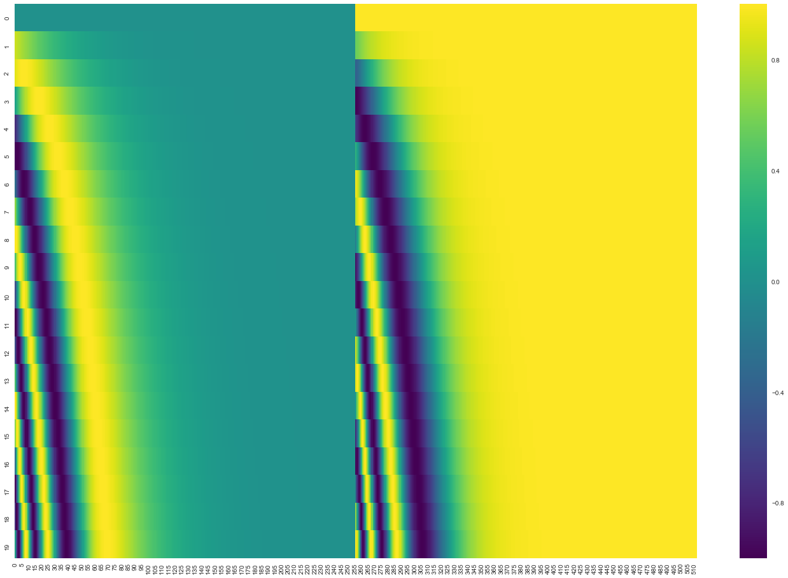

20 个词（行）、嵌入尺寸 512（列）的位置编码实例。它从正中间分成两半。左半边的值由一个函数生成，用的是正弦；右半边由另一个函数生成，用的是余弦。然后拼在一起，成为每个位置编码向量。

位置编码的公式在论文第 3.5 节。生成位置编码的代码在 [`get_timing_signal_1d()`](https://github.com/tensorflow/tensor2tensor/blob/23bd23b9830059fbc349381b70d9429b5c40a139/tensor2tensor/layers/common_attention.py)。这不是唯一的位置编码办法。它的好处是能外推到没见过的序列长度。比如，训好的模型被要求去翻译一句比训练集里任何句子都长的话。

**2020 年 7 月更新：**

上面那张位置编码来自 Tensor2Tensor 的实现，正弦和余弦分成左右两半再拼起来。论文把两种信号交错编进同一个向量。下面这张图是论文的样子。[生成它的代码在这里](https://github.com/jalammar/jalammar.github.io/blob/master/notebookes/transformer/transformer_positional_encoding_graph.ipynb)。

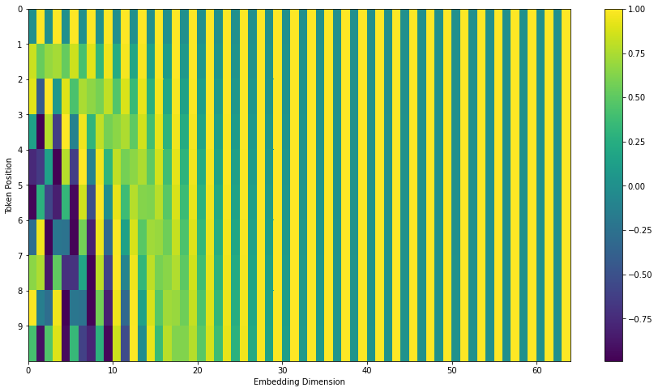

## 残差

编码器结构里还有一个细节，往下讲之前得提一下。每个编码器里的每个子层（自注意力、前馈网络）外面都套着一条残差连接，后面再接一次 [层归一化](https://arxiv.org/abs/1607.06450)。

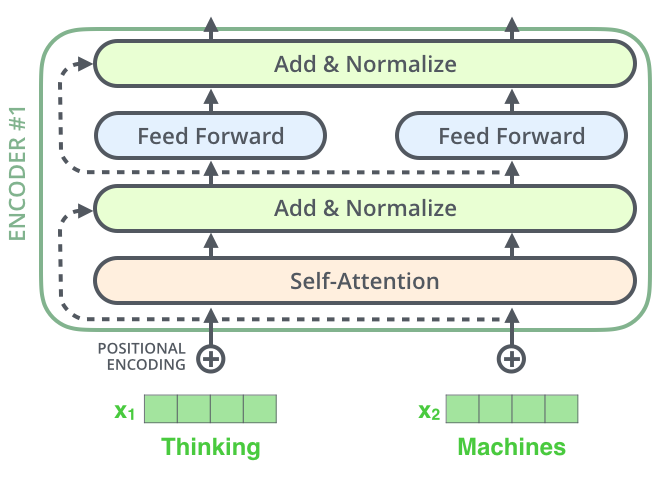

如果把和自注意力相关的向量以及层归一化画出来，是这样：

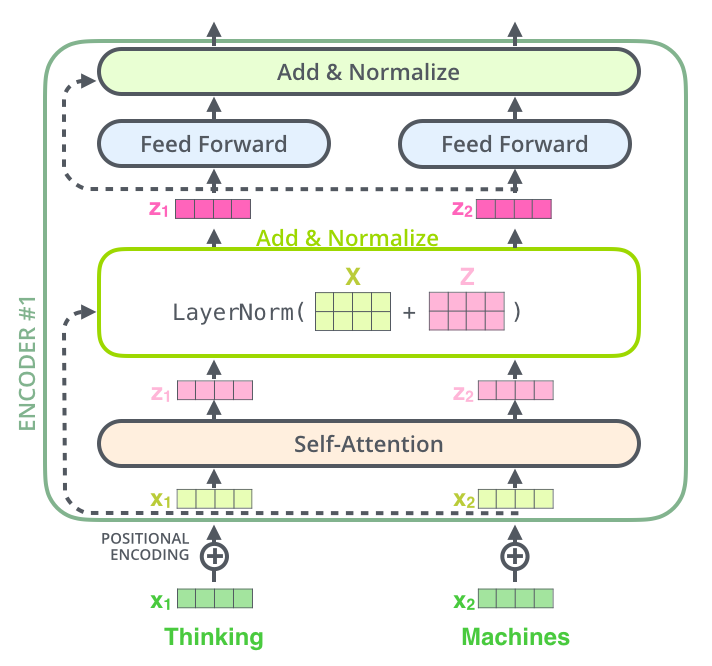

解码器的子层也一样。如果想象一个只有 2 层编码器和 2 层解码器的 Transformer，大概是这样：

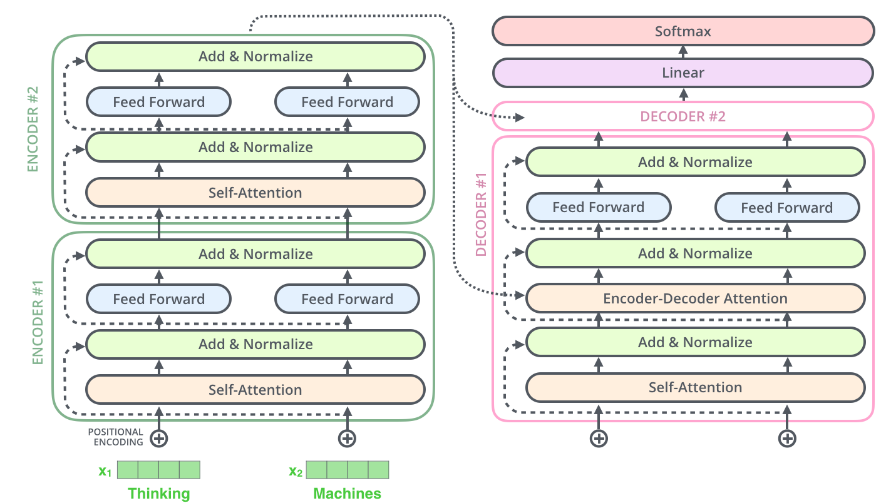

## 解码器这一侧

编码器这边的概念大部分讲过了，解码器里的部件其实也就会了。再看它们怎么配合。

编码器先处理输入序列。最上面那个编码器的输出，接着被变成一组注意力向量 K 和 V。每个解码器的「编码器-解码器注意力」层都会用到它们，用来帮解码器关注输入序列里合适的位置：

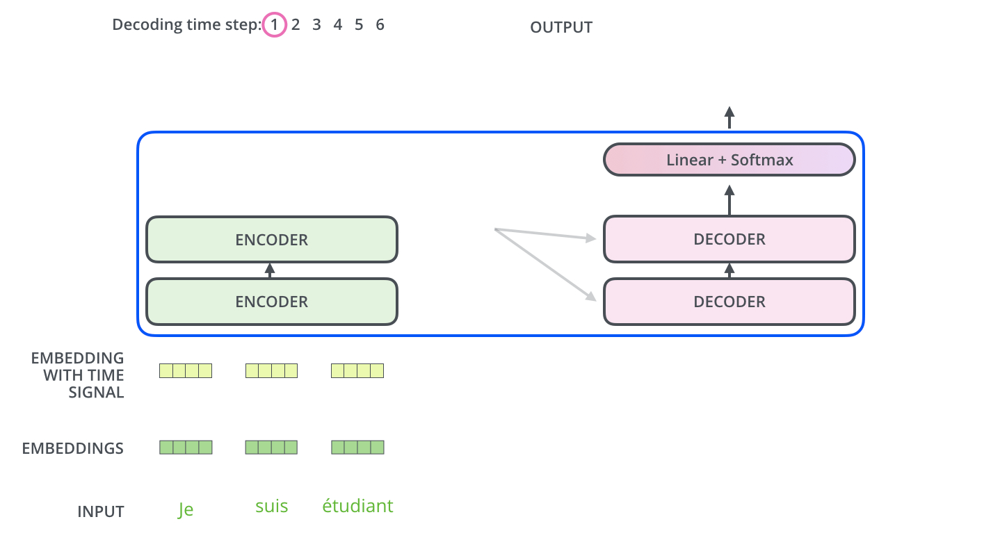

编码阶段结束后，开始解码。解码的每一步都从输出序列里吐出一个元素。这个例子里，输出序列就是英语译文。

接下来重复这个过程，直到出现一个特殊符号，表示 Transformer 解码器已经把输出做完。每一步的输出会在下一个时间步送进最底下的解码器，解码器再像编码器那样把解码结果往上冒。和编码器的输入一样，这些解码器输入也会先做嵌入，再加上位置编码，用来标明每个词的位置。

解码器里的自注意力层，和编码器里的那层有一点不同：

在解码器里，自注意力层只允许关注输出序列里更早的位置。做法是在自注意力计算的 softmax 之前，把未来的位置遮掉（设成 `-inf`）。

「编码器-解码器注意力」层的工作和多头自注意力一样，只有一处不同：它的 Query 矩阵来自它下面那一层，Key 和 Value 矩阵来自编码器栈的输出。

## 最后的线性层和 Softmax

解码器栈输出的是一个浮点向量。怎么把它变成一个词？这是最后那个线性层的事，线性层后面接着一个 Softmax 层。

线性层就是一个简单的全连接神经网络。它把解码器栈产生的向量，投影成一个大得多的向量，叫做 logits 向量。

假设模型认识 10,000 个不同的英语词（模型的「输出词表」），这些词是从训练集里学来的。logits 向量就有 10,000 格宽，每一格对应一个词的分数。线性层之后，模型的输出就是这样读的。

softmax 层再把这些分数变成概率（全是正数，加起来等于 1.0）。概率最高的那一格被选中，和它对应的词就是这个时间步的输出。

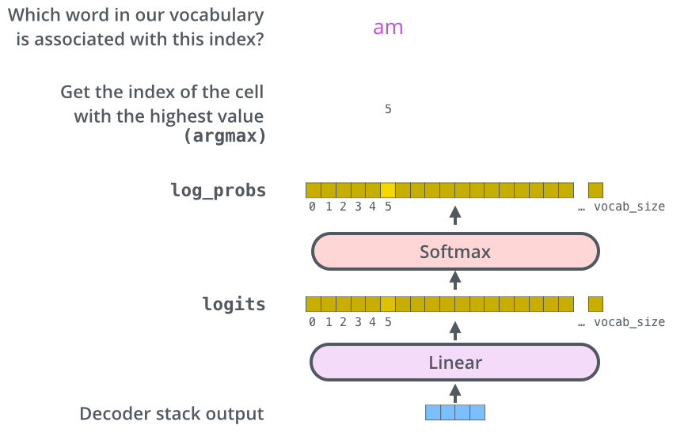

这张图从底部的解码器栈输出向量画起，最后变成一个输出词。

## 训练回顾

一个训好的 Transformer，整条前向过程讲完了。看一眼训练时的直觉会有帮助。

训练时，一个还没训过的模型走的是同一条前向路径。因为我们在带标签的训练集上训它，可以把模型的输出和真正正确的输出比一比。

为了画出来，假设输出词表里只有六个词：a、am、i、thanks、student，以及 `<eos>`（end of sentence 的缩写）。

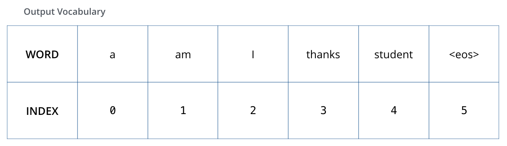

模型的输出词表是在训练开始之前的预处理阶段建好的。

词表定了之后，可以用一个同样宽度的向量来表示词表里的每一个词。这也就是 one-hot 编码。比如，词 am 可以用下面这个向量表示：

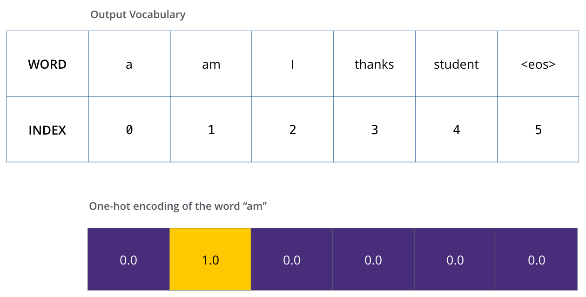

输出词表的 one-hot 编码示例。

回顾到这里，接下来讲模型的损失函数。训练阶段优化的就是这个指标，目标是得到一个训好的、希望足够准的模型。

## 损失函数

假设正在训练模型。假设这是训练阶段的第一步，例子很简单：把 merci 翻译成 thanks。

这意味着，我们希望输出是一个概率分布，指向 thanks 这个词。模型还没训过，眼下不太可能做到。

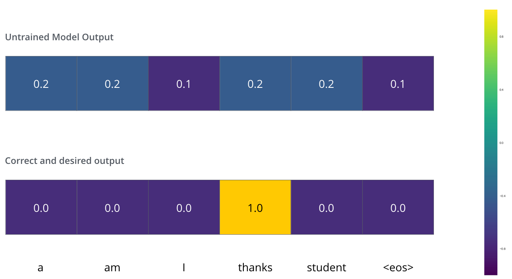

模型的参数（权重）全都随机初始化，所以这个还没训的模型会给每一格、每一个词一个任意的概率。可以拿它和真实输出比，再用反向传播去改全部权重，让输出靠近想要的输出。

两个概率分布怎么比？把一个减去另一个就行。更细的讲法可以看[交叉熵](https://colah.github.io/posts/2015-09-Visual-Information/)和 [Kullback-Leibler 散度](https://www.countbayesie.com/blog/2017/5/9/kullback-leibler-divergence-explained)。

不过这是一个过度简化的例子。更现实的情况会用长过一个词的句子。比如输入 je suis étudiant，期望输出 i am a student。这真正的意思是，我们希望模型依次吐出一组概率分布，其中：

- 每个概率分布是一个宽度为 `vocab_size` 的向量。玩具例子里是 6，更现实的数字是 30,000 或 50,000。
- 第一个概率分布里，概率最高的那一格对应词 i。
- 第二个概率分布里，概率最高的那一格对应词 am。
- 依此类推，直到第五个输出分布指向 `<end of sentence>`。这个符号在那 10,000 个元素的词表里也有自己的一格。

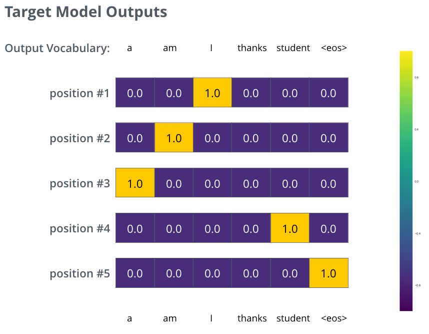

一个样本句在训练时要对齐的目标概率分布。

在足够大的数据集上训足够久之后，我们希望模型产出的概率分布长这样：

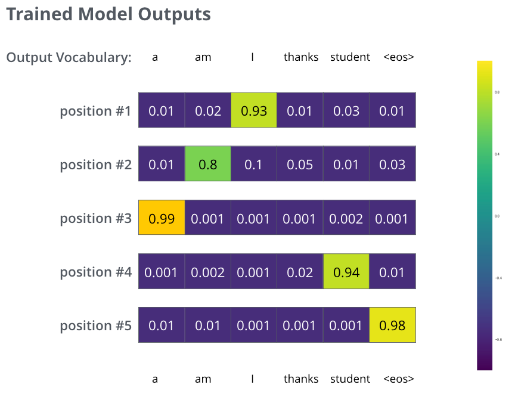

训练之后，希望模型吐出我们期待的正确译文。当然，如果这句话本来就在训练集里，这并不能真正说明问题（见[交叉验证](https://www.youtube.com/watch?v=TIgfjmp-4BA)）。注意每个位置都会分到一点点概率，哪怕它不太可能是这个时间步的输出。这是 softmax 一个很有用的性质，对训练有帮助。

模型一次只产出一个输出，所以可以假定它从那个概率分布里挑出概率最高的词，把其余的丢掉。这是一种做法，叫贪心解码。另一种做法是先留住前两名，比如 I 和 a。下一步把模型跑两遍：一遍假设第一个输出位置是 I，另一遍假设第一个输出位置是 a。哪一版在 1 号和 2 号位置上的误差更小，就留下哪一版。2 号和 3 号位置再重复。这个方法叫集束搜索。上面的例子里 `beam_size` 是 2，意思是任何时刻内存里都留着两个部分假设（还没译完的译文）；`top_beams` 也是 2，意思是最后返回两份译文。这两个都是可以试的超参数。

## 去变换吧

希望这篇能帮你和 Transformer 的主要概念破个冰。如果还想往下走，我建议这几步：

- 读 [Attention Is All You Need](https://arxiv.org/abs/1706.03762) 论文、博客 [Transformer: A Novel Neural Network Architecture for Language Understanding](https://ai.googleblog.com/2017/08/transformer-novel-neural-network.html)，以及 [Tensor2Tensor 的发布说明](https://ai.googleblog.com/2017/06/accelerating-deep-learning-research.html)。
- 看 [Łukasz Kaiser 的演讲](https://www.youtube.com/watch?v=rBCqOTEfxvg)，他把模型和细节走了一遍。
- 玩 [Tensor2Tensor 仓库里的 Jupyter Notebook](https://colab.research.google.com/github/tensorflow/tensor2tensor/blob/master/tensor2tensor/notebooks/hello_t2t.ipynb)。
- 翻一翻 [Tensor2Tensor 仓库](https://github.com/tensorflow/tensor2tensor)。

后续工作：

- [Depthwise Separable Convolutions for Neural Machine Translation](https://arxiv.org/abs/1706.03059)（神经机器翻译中的深度可分离卷积）
- [One Model To Learn Them All](https://arxiv.org/abs/1706.05137)（一个模型学会所有任务）
- [Discrete Autoencoders for Sequence Models](https://arxiv.org/abs/1801.09797)（序列模型的离散自编码器）
- [Generating Wikipedia by Summarizing Long Sequences](https://arxiv.org/abs/1801.10198)（通过摘要长序列生成维基百科）
- [Image Transformer](https://arxiv.org/abs/1802.05751)（图像 Transformer）
- [Training Tips for the Transformer Model](https://arxiv.org/abs/1804.00247)（Transformer 的训练技巧）
- [Self-Attention with Relative Position Representations](https://arxiv.org/abs/1803.02155)（带相对位置表示的自注意力）
- [Fast Decoding in Sequence Models using Discrete Latent Variables](https://arxiv.org/abs/1803.03382)（用离散隐变量加速序列模型解码）
- [Adafactor: Adaptive Learning Rates with Sublinear Memory Cost](https://arxiv.org/abs/1804.04235)（Adafactor：亚线性内存开销的自适应学习率）

## 致谢

感谢 [Illia Polosukhin](https://twitter.com/ilblackdragon)、[Jakob Uszkoreit](http://jakob.uszkoreit.net/)、[Llion Jones](https://www.linkedin.com/in/llion-jones-9ab3064b)、[Lukasz Kaiser](https://ai.google/research/people/LukaszKaiser)、[Niki Parmar](https://twitter.com/nikiparmar09) 和 [Noam Shazeer](https://dblp.org/pers/hd/s/Shazeer:Noam) 对本文早期版本的反馈。

勘误和反馈可以在 [Twitter](https://twitter.com/JayAlammar) 上找作者。

写于 2018 年 6 月 27 日。

本作品采用 [知识共享 署名-非商业性使用-相同方式共享 4.0 国际许可协议](https://creativecommons.org/licenses/by-nc-sa/4.0/) 进行许可。

署名示例：

Alammar, J (2018). The Illustrated Transformer [Blog post]. Retrieved from https://jalammar.github.io/illustrated-transformer/
